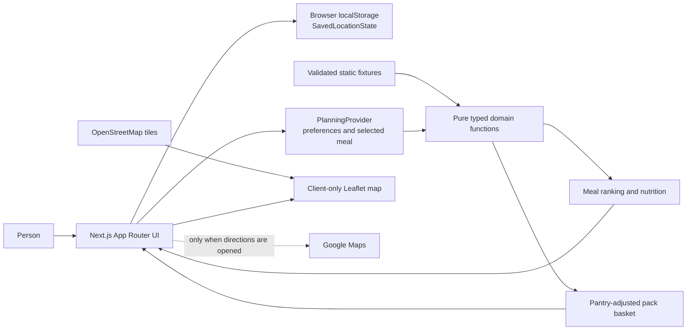

# YWC21 interview handoff (draft)

**Status:** rehearsal draft. The public demo is live at [tumraigin.peeranat-0709.chatgpt.site](https://tumraigin.peeranat-0709.chatgpt.site), but its interactive golden path has not yet been browser-verified on the hosted site. The canonical GitHub source remains private while the release source-history issue is unresolved. The owner still needs to rehearse the walkthrough and explain the trade-offs in their own words.

## 90-second demo script

> **0–15 sec — Places:** “ทำไรกินเป็นตัวช่วยการวางแผนทำอาหารกินเองของคุณ เริ่มจากเลือกและบันทึกสถานที่บนแผนที่” (Tumraigin is your helper for planning home-cooked meals, starting with places you choose and save on a map.) I name the point and save it. The app does not ask for GPS; saved places stay in this browser.
>
> **15–30 sec — Preferences:** “ถ้ายังไม่อยากตั้งงบหรือข้อจำกัด ข้ามได้” (Preferences are optional.) I skip the preference step so the app shows all eight meal examples without a hidden filter.
>
> **30–45 sec — Choices and details:** I compare the meal choices, open one plan's details, and show its servings, raw ingredient weights, calculated per-serving nutrition, source references, and any nutrients whose values are unknown.
>
> **45–70 sec — Shopping list:** I choose the meal. It needs 120 g of rice; entering 100 g in the pantry leaves 20 g to buy. The estimate rounds that shortage up to one simulated 1,000 g pack, with 980 g left after cooking. At 120 g owned, the rice pack disappears and checkout changes from ฿160.00 to ฿105.00.
>
> **70–90 sec — Limits:** “ตัวเลขราคาเป็นข้อมูลจำลอง และจุดร้านไม่ใช่สาขาจริง” (Prices are simulated; the map point is not a real branch.) Nutrition is an estimate, stock is unknown, and opening directions shares the selected coordinates with Google Maps. The list and meal calculations use local app data without GPS or an application API.

## One-page architecture overview

| Record | What it represents | Boundary to explain |
| --- | --- | --- |
| `Ingredient` | Canonical food name, per-100-g nutrients, and source provenance | Nutrient values can be unknown. |
| `Recipe` | Servings, instructions, and exclusion tags | The app calculates outputs; fixtures do not store totals. |
| `RecipeIngredient` | A recipe-to-ingredient link with raw edible grams | Weights are before cooking. |
| `ProductOffer` | Simulated chain-level pack size and integer-satang price | It does not prove branch price or stock. |
| `Store` | A candidate point used for distance and directions | The only current point is fictitious and separate from saved pins. |
| `SavedLocationState` | User-named map points and selected ID | Stored in this browser only; never sent to the app server. |

**Calculation path:** source nutrients per 100 g are scaled by each recipe ingredient’s raw edible grams, then divided by servings. Required ingredient grams are aggregated before pantry subtraction; shortages clamp at zero. Positive shortages use whole-pack ceiling arithmetic. Checkout cash is the sum of pack prices in satang; consumed-portion cost is a separate estimate. Recipe ranking applies exclusions and the optional checkout/protein thresholds; missing price or nutrient evidence remains `unknown`, not a pass.

**Runtime and trade-off:** the v0.1 app is a Next.js modular monolith with browser-local planning state and reviewed static fixtures. No app database, GPS call, or business API is required. The release candidate is configured for static export because its routes use build-time fixtures; this keeps hosting simple and the core flow reproducible. The trade-off is that fixtures are limited and not fresh retailer data. OpenStreetMap tile requests reveal the viewed area to the tile provider; if tiles fail, coordinate entry, saved places, and the demo area remain available.

## Ten interview answers

1. **Why a modular monolith and no database?** One Next.js app keeps the interview slice easy to build and deploy; domain calculations remain pure modules. Static fixtures and browser state satisfy the current no-account journey, and a database would add setup without enabling a required v0.1 behavior.

2. **How are the data entities different?** `Ingredient` is reusable food/nutrient data; `Recipe` is a meal; `RecipeIngredient` connects them with raw grams. `ProductOffer` estimates a chain-level pack and price. `Store` is a map point, while a user’s saved pin is separate and proves no store or stock.

3. **Why aggregate before subtracting pantry?** Add all recipe demand for an ingredient first, then subtract the pantry quantity once. For the same ingredient this avoids subtracting the same pantry stock repeatedly; `max(required − owned, 0)` prevents negative shopping quantities.

4. **Why round packs up, and why separate costs?** `ceil(shortageGrams / packGrams)` buys enough whole packs, so any positive shortage needs at least one. Checkout cash is what the shopper pays for full packs; consumed cost estimates only the portion used. The budget uses checkout cash.

5. **Where does nutrition come from?** Most curated values use ASEANFOODS 2014; the generic oil profile cites USDA SR28 as a proxy. The calculator scales per-100-g values and divides by servings. Unknown source nutrients remain `null` and lower completeness; cooking yield and nutrient retention are not modeled.

6. **How does ranking handle constraints?** Exclusion tags are hard exclusions. A known protein value below the minimum or checkout above budget is ineligible; incomplete evidence is `unknown`, never a pass. Eligible recipes rank before unknown and ineligible recipes, then by the configured protein preference, checkout cost, and a stable recipe ID. Skipping preferences applies no hidden filter.

7. **What is simulated versus verified?** Product names/pack sizes/prices are simulated and stock is `unknown`. The demo-store point is fictitious. The app does not imply a live retailer relationship, current branch price, or inventory from a map point.

8. **Why is straight-line distance not a route estimate?** `haversineMeters` computes the great-circle distance between two coordinates. It does not include streets, traffic, transit, travel time, or a route. The directions link opens Google Maps only after the user chooses it.

9. **What happens to saved places if map tiles fail?** Named pins and the selected ID are validated in versioned `localStorage`; there is no GPS prompt or app-server upload. Coordinate entry, saved locations, and the demo-area option remain usable without tiles. The tile provider sees the visible map area, and Google Maps receives coordinates only if directions are opened.

10. **What tests protect the calculations, and what changes for production?** The current suite has 80 unit tests across eight files for validation, nutrition, pantry, packs, baskets, ranking, and geospatial helpers. A 390 × 844 browser walkthrough checked the map-to-shopping flow and static export. Production needs the unresolved data-reuse review, authorized fresh data sources, a public release path that protects private Git history, deployed smoke verification, and ongoing privacy/security checks.

### Teach-back shortcut

Explain one basket example as **input → transform → output → edge cases**: 120 g required rice and 100 g owned → subtract once to get 20 g shortage → buy one simulated 1,000 g pack, leaving 980 g → at 120 g owned, buy no rice. Zero shortage costs zero; a missing offer produces an incomplete basket. The core per-recipe calculations iterate over a small ingredient list, and tests verify the exact boundary and recalculated visible totals.
